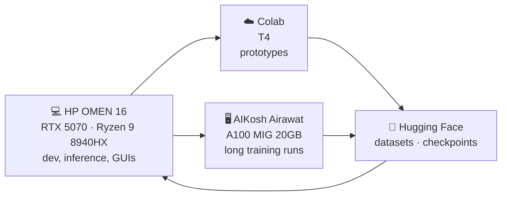

<div align="center">


<a href="https://github.com/RohitPoul">
  
</a>

<br/>

<a href="https://github.com/RohitPoul"></a>
<a href="https://huggingface.co/RohitPoul"></a>
<a href="https://github.com/RohitPoul/Person-3-Reload-Potfolio"></a>

</div>

---

## `$ whoami`

```console
rohit@dev:~$ whoami
rohit-poul  # AI/ML developer, software engineer, open-source tinkerer

rohit@dev:~$ cat focus.txt
deep learning · computer vision · bot development · cross-platform apps

rohit@dev:~$ nvidia-smi --query-gpu=name --format=csv,noheader
NVIDIA GeForce RTX 5070 Laptop GPU       # local: inference, tooling, quick tests
NVIDIA A100 (MIG 20GB) @ AIKosh Airawat  # HPC: the long training runs
Tesla T4 @ Google Colab                  # prototyping & demos

rohit@dev:~$ echo $PHILOSOPHY
learn by building, contribute openly, ship something people can actually use
```

## `class Rohit`

```python
class Rohit:
    handle      = "RohitPoul"
    focus       = ["deep learning", "computer vision", "bot development"]
    languages   = ["Python", "C++", "JavaScript"]
    frameworks  = ["PyTorch", "TensorFlow", "Electron", "React", "Telethon"]
    building    = "anime character matting with a fine-tuned BiRefNet"
    motto       = "I don't want money, I want to learn and contribute."

    def collaborate(self, idea) -> bool:
        return idea.is_interesting and idea.is_open_source
```

---

## 🔭 Currently Building

| Project | What it is | Stack |
|---|---|---|
| 🎨 **[BiRefNet Anime Matting](https://huggingface.co/RohitPoul/BiRefNet-anime-matting)** | Fine-tuning BiRefNet-HR for clean anime character cutouts. Three-phase curriculum: frozen backbone → full fine-tune → edge refinement. | PyTorch · bf16 AMP · EMA · `torch.compile` |
| 🌑 **PokeEclipse** | A Telegram-native Pokémon game: stats-based combat, gym battles, trading, a TCG card system, and a diffusion-based "illusion" CAPTCHA to keep bots out. | Python · Telethon · Stable Diffusion + ControlNet |
| 🕹️ **[Persona 3 Reload Portfolio](https://github.com/RohitPoul/Person-3-Reload-Potfolio)** | A portfolio site that looks like it was ripped out of a JRPG menu. | HTML · CSS · JS |

## 🧰 Tech Stack

<p align="center">
  
</p>

## ⚙️ Compute Rig



---

## 🏆 Featured Projects

<div align="center">

<a href="https://github.com/RohitPoul/Telegram-Sticker-Maker-And-Auto-Uploader">
  
</a>
<a href="https://github.com/RohitPoul/Background-Remover-Ai">
  
</a>
<a href="https://github.com/RohitPoul/Person-3-Reload-Potfolio">
  
</a>

</div>

## 📊 Stats

<div align="center">


<br/>


<br/>


</div>

---

## 🤝 Let's Build Something

Got a wild idea in computer vision, a Telegram bot that needs to exist, or an open-source project that needs another pair of hands? Open an issue, ping me on GitHub, or find me on Hugging Face.

<div align="center">

> *"I don't want money, I want to learn and be there, contributing to open source and making something useful for people."*


</div>
